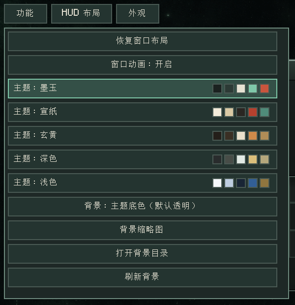
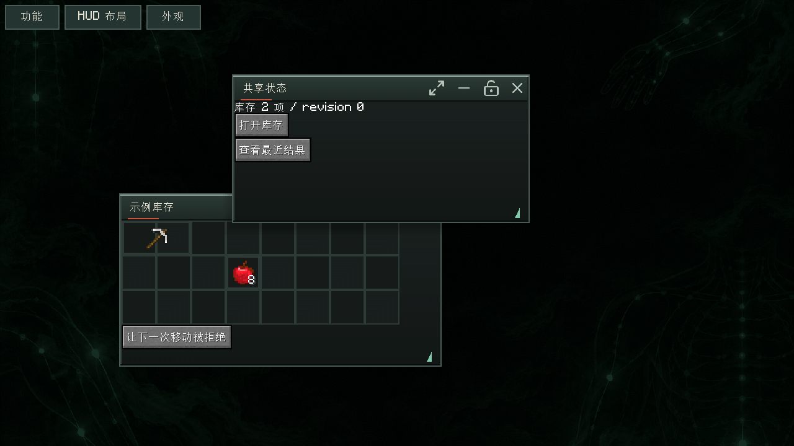
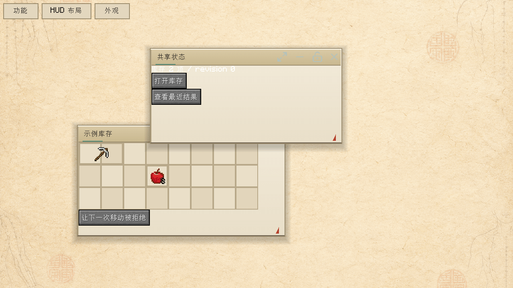
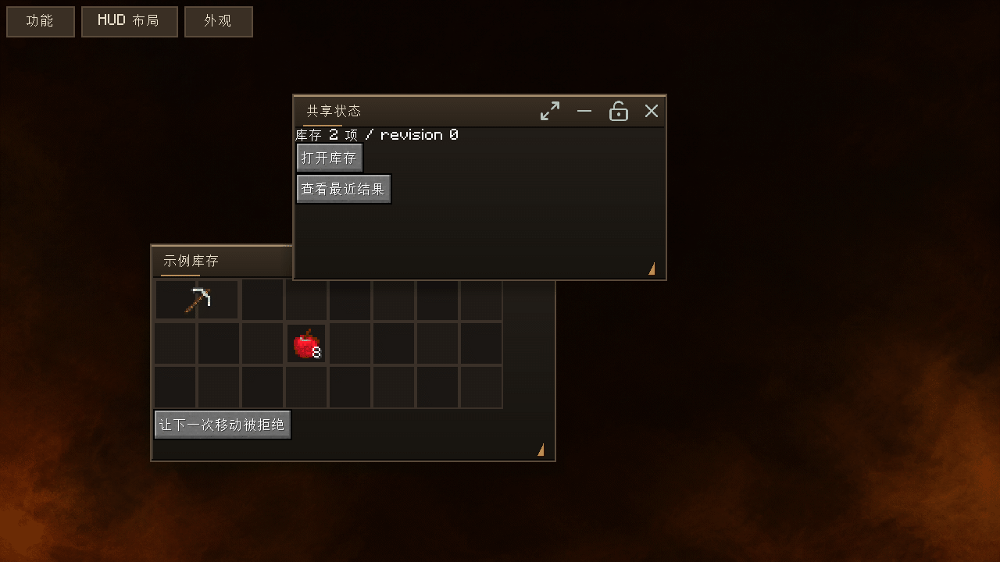

# 主题与背景

> 状态：部分实现。已实现主题颜色、背景资源加载、铺放及缺失回退。选择立即应用，并支持本地偏好保存；未提供独立的预览／确认事务。

## 主题与背景分别注册

当前主题控制框架组件颜色、文字色和边框色；尺寸沿用共享布局常量，窗口动画单独设置。背景控制工作台底图及铺放方式。用户可以组合不同来源的主题与背景，切换背景不应改变槽位容量或业务状态。

当前 `Theme(id, title, colors)` 保存外观菜单标题和不可变的 ARGB 颜色令牌表，两参数 `Theme(id, colors)` 以 ID 作标题；`Background(id, resourceId, fit)` 保存资源 ID 和 `COVER`、`CONTAIN`、`TILE` 铺放方式。`ClientRuntime.theme(id)` 和 `background(id)` 立即应用选择，工作台“外观”菜单从注册目录生成。`background(null)` 恢复主题底色。默认墨玉主题的工作台底色完全透明，且不默认选择背景图片：游戏内直接显示原本的世界画面，不加暗幕、不切换摄像机；玩家使用第一人称时保留第一人称视角。没有游戏世界的独立演示使用原版菜单背景，避免透明区域残留上一帧。背景通过 Minecraft 资源管理器加载，F3+T 清空尺寸缓存，读取失败记录资源 ID 并显示主题底色。纹理由 Minecraft 纹理管理器管理。

| 注册项 | 需要描述的内容 |
|---|---|
| 主题 | 稳定 ID、标题、语义化样式令牌及预览 |
| 背景 | 稳定 ID、标题、资源引用、铺放方式、遮罩及预览 |

颜色令牌在 `dev.kizuna.inventoryui.theme.ThemeTokens` 中统一命名，内置 ARGB 值集中在 `BuiltinThemes`。绘制函数通过 `runtime.color(ThemeTokens.PANEL)` 等接口读取颜色，避免散落十六进制字面量。

| 令牌常量 | 保存于主题中的键 | 用途 |
|---|---|---|
| `BACKGROUND` / `PANEL` / `HEADER` | `background` / `panel` / `header` | 工作台底色、面板和标题栏 |
| `MUTED_TEXT` | `text.muted` | 禁用操作文字 |
| `PROGRESS_TRACK` / `PROGRESS_FILL` | `progress.track` / `progress.fill` | 通用数值条背景与填充 |
| `PREVIEW_BACKGROUND` | `preview.background` | 模型画布底色 |
| `TEXT` / `ACCENT` | `text` / `accent` | 普通文字和提示 |
| `INVENTORY_BORDER` / `INVENTORY_HOVER_BORDER` | `inventory.border` / `inventory.hoverBorder` | 格子边框与悬停边框 |
| `INVENTORY_CELL_EVEN` / `INVENTORY_CELL_ODD` | `inventory.cellEven` / `inventory.cellOdd` | 网格的交替底色 |
| `INVENTORY_ITEM_BACKGROUND` / `INVENTORY_ITEM_TEXT` | `inventory.itemBackground` / `inventory.itemText` | 物品占位底色、名称和数量 |
| `INVENTORY_DROP_VALID` / `INVENTORY_DROP_INVALID` | `inventory.dropValid` / `inventory.dropInvalid` | 可接受与不可接受落点的半透明覆盖色 |
| `HUD_BACKGROUND` / `HUD_TEXT` | `hud.background` / `hud.text` | 示例 HUD 的底色和文字，扩展 HUD 也可复用 |

自定义主题可以只覆盖部分令牌，缺省令牌回退到内置 `kiui:dark`（不随默认主题改变），未知令牌最终回退为白色；内置主题见下文[内置主题](#内置主题)，均定义全部令牌。显式透明色同样是有效覆盖值。子组件可读取 `runtime.color(token)`，但框架不会自动重设任意 owo 子组件的样式。

库存网格使用 `new InventoryGridComponent(state, containerId, cellSize, moves, runtime::color)` 时，每帧读取当前主题，已打开的网格在切换外观后立即更新。保留的四参数构造方法使用内置深色主题，适用于独立使用场景。示例 HUD 同样在绘制回调中读取主题；不缓存构造时的颜色。

布局尺寸、边距和交互步长目前通过有单位说明的常量管理；跨工作台、窗口适配器及输入命中的尺寸共享 `WorkspaceMetrics`。标题栏为 22 逻辑像素，普通管理按钮宽 22、关闭按钮宽 20，紧凑模式宽 18；图标显示为 14×14。窗口转场为 180 ms 三次 ease-out，可通过外观菜单或 `runtime.motion(false)` 关闭。间距的可注册主题令牌尚未实现。

## 内置主题

窗口控制图标随当前主题文字色染色，宣纸与浅色主题同样保持可读对比度。

框架模块 `kiui:core` 内置六套主题，均定义全部颜色令牌。主题跟着界面版本走：新版界面只有 `kiui:glass`，旧版界面有另外五套、默认 `kiui:ink_jade`，偏好里的 `theme` 记的是旧版的选择（见 [模块与窗口](Modules-and-Windows.md) 的「两版界面」）。外观菜单按注册顺序列出“主题：标题”，每行右侧依次显示目标主题的面板、标题栏、文字、强调和标题短线五个色块，当前主题以强调色描边。选择立即生效，离开工作台时写入本地偏好。

小窗直接画在游戏画面上，文字和进度条槽另有三个令牌：`compact.text`、`compact.text.muted`、`compact.track`；主题没写时取 `text`、`text.muted`、`progress.track`。

### 图标风格（新版界面）

新版界面的图标有三种风格：`item`「物品」、`glass_line`「琉璃细线」（默认）、`ink`「水墨」。玩家在新版「外观」菜单的「图标：…」三行里选，或用客户端命令 `/kiui icons item|glass_line|ink`；选择存在偏好的 `modern.icons`。旧版界面没有这一项，标题栏图标不变。

- 贴图路径是 `assets/<命名空间>/textures/gui/icons/<风格>/<图标名>.png`。图标属于哪个模块就放在哪个模块的资源里，三种风格各放一张同名的图。
- 画图标前调 `ClientRuntime.icon(Identifier.fromNamespaceAndPath("<命名空间>", "<图标名>"))` 取当前风格的贴图。框架只按「风格 + 图标 ID」拼路径，不认识具体功能。
- 某种风格缺图时，日志里记一条错误（风格、图标 ID、应有的贴图路径），人在游戏里时聊天栏也提示一次，图标位置画出缺图的格子；不会换成别的风格的图。资源重新加载后重新检查。`ClientRuntime.missingIcons()` 返回已经查出缺的贴图。
- 框架自己的五张窗口按钮图标（`collapse`、`expand`、`lock`、`unlock`、`close`）在 `kizuna_inventory_ui` 命名空间下，28×28，以 7×7 逻辑像素原色显示。

| ID | 标题 | 配色 | 建议搭配背景 |
|---|---|---|---|
| `kiui:glass` | 琉璃 | 半透明深色面板、细亮边、青色标题短线；没有斜边和扩散阴影，窗下一条平投影 | 主题底色（透明） |
| `kiui:ink_jade` | 墨玉 | 墨色面板、玉色强调、朱砂标题短线 | `kiui:night_meridian` 夜脉 |
| `kiui:xuan_paper` | 宣纸 | 浅色纸底、墨字、朱砂强调、铜锈绿标题短线 | `kiui:scroll_paper` 残卷 |
| `kiui:xuan_huang` | 玄黄 | 玄色暖底、赭石强调、铜色标题短线 | `kiui:alchemy_room` 丹房 |
| `kiui:dark` | 深色 | 原灰绿渐变、浅金强调 | `kiui:cosmos` 远空 |
| `kiui:light` | 浅色 | 浅灰蓝面板、蓝色强调 | 主题底色 |

主题和背景分别选择，表中搭配只是建议；`kiui:star_meridian` 星图经络适合任一深色主题。宣纸与浅色主题像原有浅色主题一样声明近不透明的工作台底色，选择背景图片后由图片覆盖。

截图来自 Linux Xvfb 客户端，经外观菜单实际点击切换。窗口标题栏控制图标按主题文字色染色，
宣纸与浅色主题保持清晰对比。`runSmoke` 覆盖主题切换、关闭保存、从磁盘重读及重开窗口，
同时验证拖放、拆堆、跨窗转移、槽位和窗口控制。示例内容由示例模块绘制，接入方仍需使用主题令牌。

## 资源命名与选择

资源使用模块自己的命名空间，例如 `example:textures/ui/backgrounds/paper.png`。图片尺寸由加载器读取；图标显示尺寸由布局约束决定，不要求全部图标使用同一像素大小。

背景铺放可声明覆盖裁剪、完整显示或平铺。模块给出默认值，资源包可以按资源 ID 替换图像，用户设置决定当前选择。模块主题或背景暂时缺失时保留已保存的 ID，运行中使用默认外观；已注册背景资源加载失败时回退主题底色并记录资源诊断。

内置 `kiui:night_meridian`（夜脉）、`kiui:scroll_paper`（残卷）、`kiui:alchemy_room`（丹房）、`kiui:star_meridian`（星图经络）、`kiui:cosmos`（远空）和 `kiui:terrain`（暮原）作为可选背景，均为 1536×1024、`COVER` 铺放；也支持随 JAR 或资源包分发的静态资源。自定义绘制背景属于待评估扩展点，不承诺加载任意脚本或自动下载远端资源。

适用于当前 `0.1.0-SNAPSHOT` 源码：新配置默认新版界面和琉璃主题、透明背景，切到旧版界面后是墨玉主题；已有配置保存的主题与背景选择继续生效。旧配置若仍显示远空，可在“外观 → 背景：主题底色（默认透明）”清除图片选择，并选“主题：墨玉”。浅色主题及自定义主题仍可声明自己的底色。

## 偏好与预览边界

当前选择立即生效，不另设确认步骤。背景缺失时回退主题底色，资源包重载后重新解析；纹理由 Minecraft 管理。独立的预览／应用事务与动画样式扩展未包含在本版。

偏好按稳定 ID 保存，并带格式版本。模块缺失时保留用户选择记录；恢复模块后能重新解析。外观偏好独立于服务器库存、技能槽容量和业务会话。

验证资源缺失、加载失败、连续切换、资源包重载，以及背景铺放在不同宽高比下的表现。

相关文档：[模块与窗口扩展](Modules-and-Windows.md)、[HUD 与槽位栏](HUD-and-Slot-Bars.md)、[故障排查](Troubleshooting.md)。

## 默认外观与新增令牌

默认琉璃主题和墨玉主题的工作台背景都透明。窗口外框的每一层都由令牌决定：面板两段渐变、细边高光、侧边、底边压暗、扩散阴影和窗下平投影；主题把某一层设成全透明就没有那一层，琉璃只留面板、细边和平投影，墨玉等五套保留渐变、斜边和多层阴影。标题栏高度、标题位置、按钮尺寸是全局的，不随主题变；强调短线压在标题下的分隔线上，和标题文字等宽。强调色只用于标题短线、悬停边和进度。顶部保留功能和外观按钮；展开菜单的高度随内容收缩。原版 HUD 在工作台打开期间隐藏，详见 [HUD 与槽位栏](HUD-and-Slot-Bars.md)。新增令牌包括：

| 常量 | 作用 |
|---|---|
| `PANEL_BOTTOM`、`HEADER_BOTTOM` | 面板及标题渐变的下端颜色 |
| `BORDER`、`EDGE_LIGHT`、`EDGE_SIDE`、`EDGE_DARK` | 外框边线、顶部高光、侧边及底边 |
| `HEADER_RULE`、`HEADER_ACCENT`、`SHADOW` | 标题分隔线、强调短线、窗口四周的扩散阴影 |
| `SHADOW_DROP` | 紧贴窗口下沿的一条平投影；主题没写就不画 |
| `CONTROL`、`CONTROL_HOVER`、`CONTROL_CLOSE_HOVER` | 菜单按钮、悬停、关闭按钮反馈 |
| `TOOLBAR`、`TOOLBAR_BORDER`、`MENU`、`MENU_BORDER` | 前两项为保留的工具栏令牌，默认工作台不再绘制整条底板；后两项控制展开菜单 |
| `INPUT_ERROR`、`BACKGROUND_OVERLAY` | 无效尺寸提示、背景遮罩 |

这些颜色同样可由局部主题覆盖。窗口控制图标采用 Lucide，许可随资源保留。

## 本地图片与缩略图

“外观 → 背景缩略图”统一展示模块背景和本地图片，可通过“打开背景目录”放入 PNG/JPEG，再点“刷新背景”。默认目录为 `config/kizuna-inventory-ui/backgrounds/`。本地选择 ID 是 `local:<文件名>`；它只属于本地表现设置，不是模块注册 ID。

本地图片读取前检查路径与符号链接、16 MiB 文件上限、4096 像素单边上限和 8,388,608 总像素上限。最多列出 64 项，缩略图长边最多 256 像素。加载新图失败保留当前背景；刷新和退出释放缩略图纹理。F3+T 同时使资源背景、SVG 和本地缩略图缓存失效。

`runtime.configureBackgroundDirectory(path)` 可为宿主指定独立目录。选择资源失败与重新选择有意关闭背景是不同操作；`background(null)` 明确使用主题底色。窗口动画及背景选择随本地偏好保存。

展开底板读取 `expanded.panelTop` 和 `expanded.panelBottom`，缺项继承本主题的原面板两色。小窗的 `compact.backdrop` 由逐窗透明度替换 alpha，默认完全透明：透明时不画底也不画边，工作台里只在鼠标指着或拖着时画一圈细框，游戏画面里不画框。可选 `expanded.blurRadius` 的单位是 GUI 像素，全局开关默认关闭；框架目前只保存开关和半径，不做模糊，琉璃面板因此取 0.85 的不透明度，盖住的小窗文字不会透上来。
